   
  

 

  
  
  

  

---

<table align="center" width="100%">
  <tr>
    <td align="center" valign="middle" width="35%">
      
    </td>
    <td valign="middle" width="65%">
<h3><code>vishu@arch~></code>whoami⚡</h3>
<pre>
┌── [ SYSTEM DIAGNOSTICS ] ─────────────────────────┐
│ • User      › Vishu (vishu2717)                   │
│ • OS        › Arch Linux (Hyprland / Catppuccin)  │
│ • Shell     › Zsh · Starship Prompt               │
│ • Editor    › Neovim (LazyVim)                    │
│ • Core      › Rust · Go · Python · C++ · TS       │
│ • Focus     › Low-Level · DevOps · Reverse Eng    │
│ • Vibe      › Aesthetic Rice · Cyberpunk Anime    │
└───────────────────────────────────────────────────┘
</pre>
<blockquote>
<i>"Crafting elegance in the terminal, breaking binaries in the dark."</i>
</blockquote>
<h4>✦ Current Focus &amp; Deep Dives</h4>
<ul>
  <li>⚙️ <b>Low-Level Internals &amp; Systems</b>: Memory architectures, binary analysis, and performant Rust/C++</li>
  <li>🚀 <b>DevOps &amp; Infrastructure</b>: Microservices, automated deployment pipelines, and Linux server orchestration</li>
  <li>🌸 <b>Custom Wayland Desktop</b>: Pixel-perfect aesthetic workflow with Arch Linux, Hyprland, and Neovim</li>
  <li>🧠 <b>Intelligent Tools &amp; Automation</b>: Building reverse engineering utilities, CLI toys, and modern backends</li>
</ul>
</td>
  </tr>
</table>

<!-- ---

  

 

--- -->

<h2 align="center"> Languages · Technologies · Tools </h2>
 

<table align="center">
  <tr>
    <td align="center" width="96">
      
    </td>
    <td align="center" width="96">
      
    </td>
    <td align="center" width="96">
      
    </td>
    <td align="center" width="96">
      
    </td>
    <td align="center" width="96">
      
    </td>
    <td align="center" width="96">
      
    </td>
  </tr>

  <tr>
    <td align="center" width="96">
      
    </td>
    <td align="center" width="96">
      
    </td>
    <td align="center" width="96">
      
    </td>
    <td align="center" width="96">
      
    </td>
    <td align="center" width="96">
      
    </td>
    <td align="center" width="96">
      
    </td>
  </tr>

  <tr>
    <td align="center" width="96">
      
    </td>
    <td align="center" width="96">
      
    </td>
    <td align="center" width="96">
      
    </td>
    <td align="center" width="96">
      
    </td>
    <td align="center" width="96">
      
    </td>
    <td align="center" width="96">
      
    </td>
  </tr>
</table>

 

<!-- 

  

 -->

